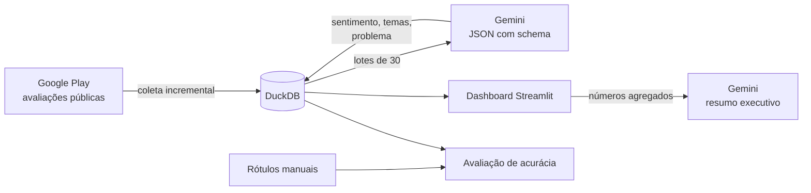

# Radar de Avaliações de Apps de Delivery

Coleta as avaliações públicas de apps de delivery na Google Play, classifica cada uma por **sentimento e tema** com o Gemini (plano gratuito) e mostra num dashboard **do que os clientes reclamam, o que mais derruba a nota e como isso muda semana a semana**, com um resumo executivo escrito pela IA para o time de produto.

Hoje compara **iFood** e **Rappi**. Outros apps entram com uma linha em `radar/config.py`.

> 📸 _Coloque aqui um print do dashboard com os dados reais._

## O problema

Um app grande recebe milhares de avaliações por semana. Ler todas é inviável, e a nota média sozinha não diz **o que** consertar. O Radar transforma texto livre em categorias comparáveis, para o time de produto priorizar com dados: qual problema é mais frequente, qual pesa mais na nota e se uma atualização fez algum tema disparar.

## Como funciona



1. **Coleta** (`radar/coleta.py`): busca as avaliações mais recentes e para ao encontrar as que já estão no banco, então pode rodar todo dia sem duplicar. Não guarda nome nem foto de quem avaliou.
2. **Classificação** (`radar/classificador.py`): envia lotes de 30 avaliações numeradas e recebe JSON validado por um schema Pydantic: sentimento, de 1 a 3 temas de uma **taxonomia fixa de 14 temas** (atraso, entregador, pedido errado, cupons, taxas, suporte, bugs...) e uma frase com o problema. Lotes reduzem as chamadas em cerca de 30 vezes, o que importa no plano gratuito. Se o modelo pular alguma avaliação, ela é reenviada; se o limite de requisições for atingido, o programa espera e tenta de novo.
3. **Análise** (`radar/analise.py`): % das avaliações negativas que citam cada tema, **impacto na nota** (nota média de quem cita o tema menos a média do app), tendência semanal e exemplos reais.
4. **Avaliação** (`radar/avaliacao.py`): compara a classificação do LLM com uma amostra rotulada à mão. Mede acurácia de sentimento (contra um baseline que só olha as estrelas) e precisão, recall e F1 por tema.

### Decisões de projeto

- **Taxonomia fixa em vez de temas livres**: permite comparar apps e semanas. Mudou o prompt ou os temas? Atualize `VERSAO_PROMPT`; cada classificação guarda a versão e o modelo usados.
- **Sentimento pelo texto, não pelas estrelas**: é comum alguém dar 5 estrelas e reclamar, ou dar 1 estrela por engano. A avaliação mede quanto o LLM acerta a mais que as estrelas.
- **O resumo da IA recebe só números agregados**, nunca a base inteira, e é instruído a não inventar dados.
- **Privacidade**: sem nome de usuário, ID original hasheado e os textos coletados fora do repositório (`data/` está no `.gitignore`).

## Resultados

Coleta de 2.000 avaliações recentes (1.000 por app) e avaliação em 100 delas, com rótulos pré-preenchidos pelo Claude e revisados manualmente. Detalhes em [`resultados/avaliacao.md`](resultados/avaliacao.md).

| Métrica | Resultado |
|---|---|
| Acurácia de sentimento, Gemini | **97%** |
| Acurácia de sentimento, só pelas estrelas | 92% |
| Temas: F1 (micro) | **87%** |
| Avaliações com pelo menos 1 tema correto | 92% |

**Achados do dashboard**
- Atendimento/suporte e pagamento/reembolso lideram as reclamações nos dois apps, cada um em 25% a 33% das avaliações negativas.
- Atraso na entrega pesa mais na Rappi (~28% das negativas, contra ~17% no iFood); cupons e promoções pesam mais no iFood (~17% contra ~6%).
- No iFood, quem cita pedido errado, bugs ou problemas de conta dá cerca de 2,7 estrelas a menos que a média.

**O que a avaliação ensinou**
- O tema "Outro" teve recall de 46%: avaliações sobre o app não atender a cidade não têm categoria própria. Próxima versão: criar `cobertura_regiao`.
- "Atendimento e suporte" teve precisão de 64%: o modelo marca suporte quando a pessoa só não conseguiu cancelar. Ajuste: deixar essa fronteira explícita no prompt.
- As 1.000 avaliações de cada app cobrem períodos diferentes, porque o iFood recebe muito mais avaliações por dia. Comparações entre os apps são indicativas.

## Como rodar

```bash
python -m venv .venv && source .venv/bin/activate   # Windows: .venv\Scripts\activate
pip install -r requirements.txt
cp .env.example .env                                  # e coloque sua GEMINI_API_KEY (grátis no Google AI Studio)
```

### 1. Coletar e classificar

```bash
python -m radar coletar --quantidade 1000   # até 1.000 avaliações novas por app
python -m radar classificar                 # classifica as pendentes (pode rodar em partes com --limite 300)
python -m radar status                      # quanto foi coletado e classificado
```

No plano gratuito, 2.000 avaliações viram cerca de 70 chamadas ao Gemini. Se a cota do dia acabar, rode `classificar` de novo no dia seguinte: ele continua de onde parou.

### 2. Dashboard

```bash
streamlit run app.py
```

### 3. Medir a acurácia (recomendado)

```bash
python -m radar exportar-rotulos --n 100    # gera data/rotulos.csv
# abra no Excel e preencha sentimento_manual (positivo/neutro/negativo)
# e temas_manual (códigos separados por ;, ex.: atraso_entrega;atendimento_suporte)
python -m radar avaliar                     # grava resultados/avaliacao.md
```

Os códigos dos temas estão em `radar/config.py`. Rotule **sem olhar** a resposta do modelo.

### Testar sem coletar nem usar a API

```bash
python -m radar amostra      # dados sintéticos já classificados
streamlit run app.py
pytest -q
```

Os testes cobrem a coleta incremental (paginação, parada ao encontrar avaliações conhecidas, descarte de dados pessoais), a classificação (lotes, reenvio do que faltou, normalização dos temas, espera no limite de taxa), as consultas do dashboard, a avaliação de acurácia e a linha de comando. Rodam sem rede e sem chave.

## Próximos passos

- Agendar coleta e classificação diárias e alertar quando um tema subir acima do normal (ex.: bugs depois de uma atualização).
- Cruzar os temas com a versão do app para medir o efeito de cada release.
- Incluir avaliações da App Store.

## Stack

Python · Gemini API (google-genai) · Pydantic · DuckDB · Streamlit · Altair · google-play-scraper · pytest

---

As avaliações são conteúdo público da Google Play, coletado em pequena escala para estudo. O repositório não redistribui os textos. Projeto de portfólio sem relação com as empresas citadas.
